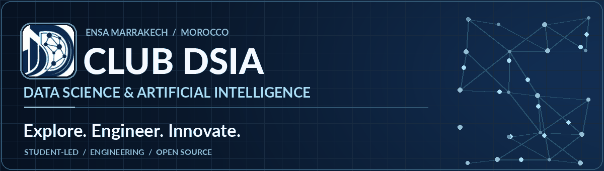

[Website](https://dsia-ensa-marrakech.pages.dev) · [LinkedIn](https://www.linkedin.com/company/dsia-ensa-marrakech/) · [Instagram](https://www.instagram.com/club_dsia/) · [Repositories](https://github.com/DSIA-ENSA-Marrakech?tab=repositories)

[English](https://github.com/DSIA-ENSA-Marrakech/.github/blob/main/profile/README.md) · **Français**

Nous sommes le Club Data Science & Intelligence Artificielle de l’École Nationale des Sciences Appliquées de Marrakech (ENSA Marrakech), au Maroc.

Notre mission est de fédérer les étudiants autour de la donnée et de l’IA à travers des projets d’ingénierie, l’apprentissage pratique et l’ouverture sur les milieux académique et professionnel. Nous souhaitons transformer les idées en solutions testables, démontrables et améliorables grâce aux retours des utilisateurs.

| Concevoir | Apprendre | Collaborer |
| :--- | :--- | :--- |
| Projets appliqués en Data Science et IA | Ateliers et ressources techniques | Échanges avec étudiants, enseignants et professionnels |

Six cellules complémentaires structurent les activités du club :

| Cellule | Mission |
| :--- | :--- |
| Cellule Projet | Conception et développement de solutions de Data Science, de Machine Learning et d’applications interactives. |
| Bureau de Conseil | Cadrage technique, revue de code, accompagnement méthodologique et veille technologique. |
| Cellule Formation | Ateliers pratiques, bootcamps et ressources pédagogiques. |
| Cellule Sponsoring & Partenariat | Relations avec entreprises, startups et partenaires institutionnels. |
| Cellule Logistique & Organisation | Coordination des événements, hackathons et conférences. |
| Cellule Design & Communication | Identité visuelle, création de contenu et rayonnement du club. |

### Découvrir nos dépôts

- [**DSIA Project Template**](https://github.com/DSIA-ENSA-Marrakech/dsia-project-template) — point de départ officiel des projets du club.
- [**Dépôts publics**](https://github.com/DSIA-ENSA-Marrakech?tab=repositories) — code et ressources publiés.

Au fil des validations, cette section présentera les problématiques, données, méthodes, évaluations, démonstrations et résultats des projets publiables.

### Notre démarche de contribution

`Problème & faisabilité` → `Conception & données` → `Développement` → `Revue & évaluation` → `Démo & retours`

Pour un projet du club, utiliser le dépôt modèle, travailler sur une branche dédiée et soumettre une Pull Request pour revue avant fusion sur `main`. Documenter la reproductibilité, protéger les données sensibles et comparer les modèles à des références pertinentes si applicable.

[Guide de contribution](https://github.com/DSIA-ENSA-Marrakech/.github/blob/main/CONTRIBUTING.md) · [Code de conduite](https://github.com/DSIA-ENSA-Marrakech/.github/blob/main/CODE_OF_CONDUCT.md) · [Politique de sécurité](https://github.com/DSIA-ENSA-Marrakech/.github/blob/main/SECURITY.md)

**Axes techniques :** Python · Analyse de données · Machine Learning · Statistiques · IA · Génie logiciel · Git

Nous sommes ouverts aux échanges avec les étudiants, enseignants, chercheurs et professionnels intéressés par la Data Science, l’IA appliquée et le partage de connaissances.

Retrouvez-nous sur notre [site officiel](https://dsia-ensa-marrakech.pages.dev) ou notre [page LinkedIn](https://www.linkedin.com/company/dsia-ensa-marrakech/).

