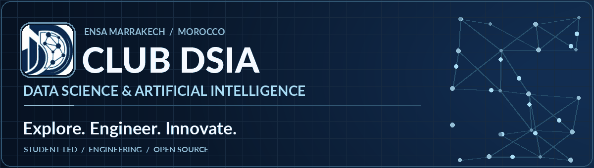

[Website](https://dsia-ensa-marrakech.pages.dev) · [LinkedIn](https://www.linkedin.com/company/dsia-ensa-marrakech/) · [Instagram](https://www.instagram.com/club_dsia/) · [Repositories](https://github.com/DSIA-ENSA-Marrakech?tab=repositories)

**English** · [Français](https://github.com/DSIA-ENSA-Marrakech/.github/blob/main/profile/README.fr.md)

We are the Data Science & Artificial Intelligence student club at the National School of Applied Sciences (ENSA Marrakech), Morocco.

Our mission is to bring students together around data and AI through hands-on engineering projects, technical learning and meaningful connections with academia and industry. We aim to turn ideas into solutions that can be tested, demonstrated and improved with feedback.

| Build | Learn | Connect |
| :--- | :--- | :--- |
| Applied data science and AI projects | Workshops and shared technical resources | Collaboration with students, faculty and industry |

Six complementary divisions support our activities:

| Division | Focus |
| :--- | :--- |
| Project Division | Design and development of data science, machine learning and interactive applications. |
| Technical Advisory Board | Technical scoping, code review, methodology and technology watch. |
| Training Division | Practical workshops, bootcamps and learning resources. |
| Sponsorship & Partnerships | Relationships with companies, startups and institutional partners. |
| Logistics & Organization | Coordination of events, hackathons and conferences. |
| Design & Communication | Visual identity, content and outreach. |

### Start here

- [**DSIA Project Template**](https://github.com/DSIA-ENSA-Marrakech/dsia-project-template) — the official starting point for club projects.
- [**Explore public repositories**](https://github.com/DSIA-ENSA-Marrakech?tab=repositories) — discover published code and resources.

As projects are approved for publication, this space will highlight their problem statements, data, methods, evaluation, demos and results. We only showcase work that is ready to share.

### Our contribution workflow

`Problem & feasibility` → `Design & data` → `Implementation` → `Review & evaluation` → `Demo & feedback`

For club projects, start from the official template, work on a dedicated branch and submit a pull request for review before merging into `main`. Document how to reproduce results, protect sensitive data and evaluate models against relevant baselines where applicable.

[Contribution guidelines](https://github.com/DSIA-ENSA-Marrakech/.github/blob/main/CONTRIBUTING.md) · [Code of conduct](https://github.com/DSIA-ENSA-Marrakech/.github/blob/main/CODE_OF_CONDUCT.md) · [Security policy](https://github.com/DSIA-ENSA-Marrakech/.github/blob/main/SECURITY.md)

**Technical focus:** Python · Data Analysis · Machine Learning · Statistics · AI · Software Engineering · Git

We welcome conversations with students, teachers, researchers and industry professionals interested in applied data science, AI and knowledge sharing.

Connect with us through our [official website](https://dsia-ensa-marrakech.pages.dev) or [LinkedIn page](https://www.linkedin.com/company/dsia-ensa-marrakech/).

